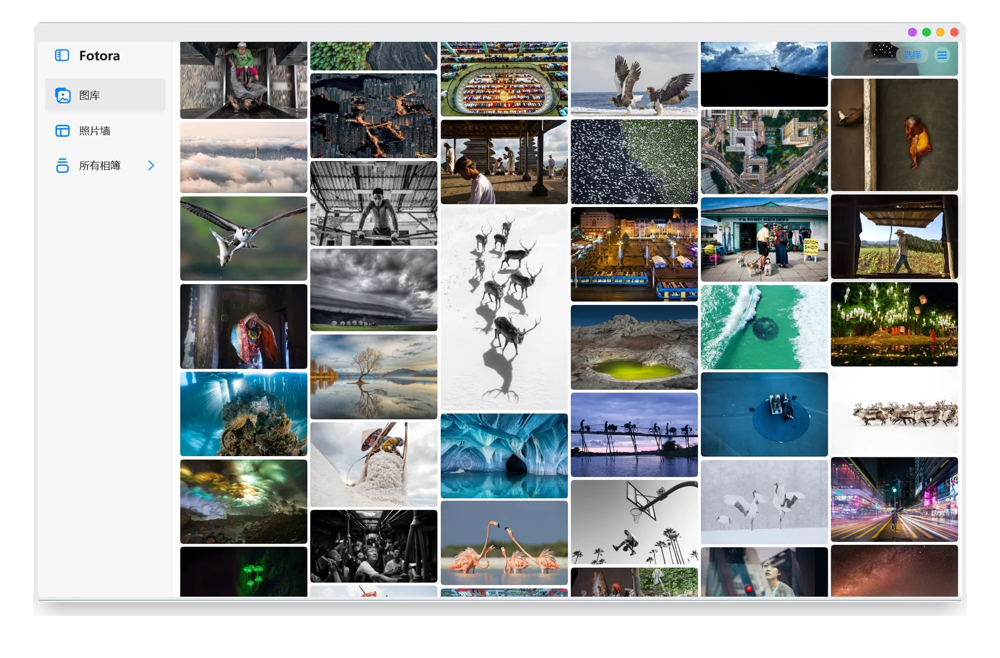
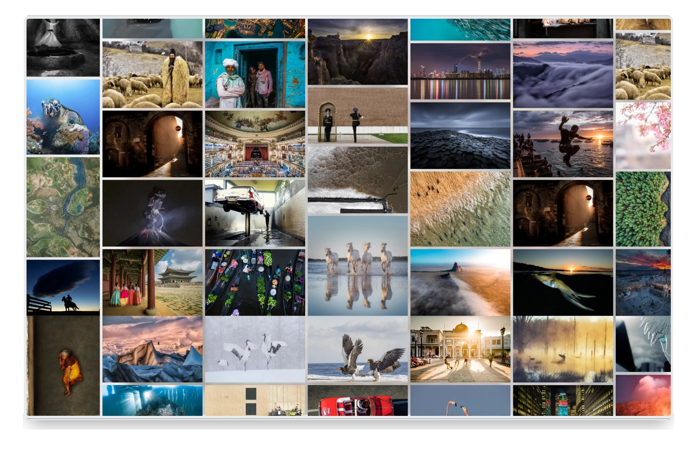
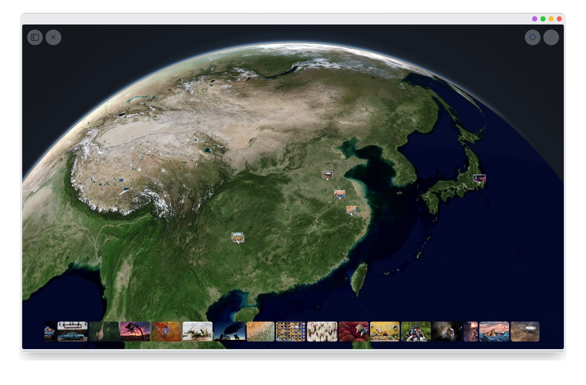
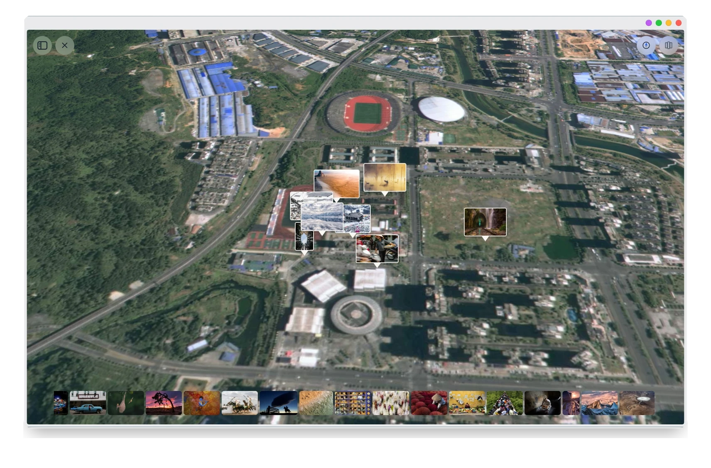
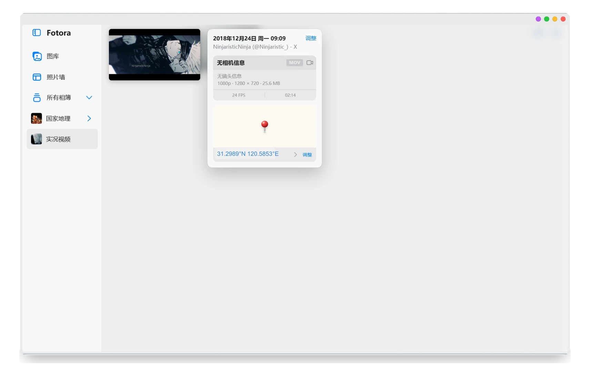

<p align="center">
  
</p>

<h1 align="center">Fotora</h1>

<p align="center">
  <strong>本地照片与视频管理器</strong>
</p>

## 功能概览

- 🔒 **本地优先**：照片不需要上传到云端，索引、缩略图和编辑缓存默认保存在本机。
- ⚡ **适合大图库**：目录扫描、增量索引和缩略图缓存针对大量照片与视频进行优化。
- 🎞️ **照片与视频统一管理**：在同一个界面中浏览、筛选、编辑和展示。
- 🛡️ **保留原始文件**：编辑与元数据调整使用副本或软件覆盖值，不随意改写原片。

## 功能

### 🗂️ 图库与相册

- 📁 从本地文件夹建立图库，自动读取照片和视频信息
- 🗃️ 创建、重命名、排序和整理独立相册
- ⭐ 收藏、星级评分，以及按日期、媒体类型、相机设备、位置和文件格式筛选
- 🖼️ 支持 JPEG、PNG、HEIC/HEIF、TIFF、WebP、常见 RAW 照片及多种视频格式

<p align="center">
  <a href="docs/images/screenshots/library.webp">
    
  </a>
  <br>
  <sub>🗂️ 图库浏览 · 🗃️ 相册导航 · 🖼️ 多种照片排列</sub>
</p>

### 🖼️ 照片墙

- 🧩 提供方形网格、等高成行、等宽成列、胶片和嵌合拼图等布局
- ✂️ 支持每种照片墙独立裁剪和幻灯片播放
- 💾 相册封面、照片墙封面与普通缩略图分别维护

<p align="center">
  <a href="docs/images/screenshots/photo-wall.webp">
    
  </a>
  <br>
  <sub>🧩 多种墙式布局 · ✂️ 独立裁剪 · 🎞️ 沉浸式浏览</sub>
</p>

### 🌍 地点足迹

- 📍 按 GPS 信息浏览照片分布
- 🗺️ 在地球和卫星地图中查看拍摄地点
- 🖼️ 点击地点中的照片标记可直接浏览对应项目

<p align="center">
  <a href="docs/images/screenshots/locations-globe.webp">
    
  </a>
  <br>
  <sub>🌍 地球视图 · 📍 照片位置 · 🗺️ 地点聚合</sub>
</p>

### 🧭 地图视角调整

- 🎛️ 地点地图支持缩放、旋转、俯仰角和倾斜方向调整
- 🛰️ 可以在区域视图和近距离卫星视图之间切换
- 🎞️ 底部胶片栏用于快速浏览和定位当前照片

<p align="center">
  <a href="docs/images/screenshots/locations-detail.webp">
    
  </a>
  <br>
  <sub>🧭 俯仰与倾斜 · 🛰️ 卫星细节 · 🎞️ 快速定位</sub>
</p>

### 📋 照片信息卡

- 🕒 查看拍摄时间、文件类型、尺寸、大小、帧率和时长
- 📷 查看相机、镜头、参数和 GPS 位置
- 🧭 在信息卡中直接调整拍摄时间与位置

<p align="center">
  <a href="docs/images/screenshots/photo-info.webp">
    
  </a>
  <br>
  <sub>📋 信息卡 · 🕒 拍摄时间 · 📷 设备参数 · 📍 GPS 位置</sub>
</p>

### ✂️ 编辑与元数据

- ✂️ 图片裁剪、旋转、几何调整与基础编辑
- 🕒 修改照片和视频的拍摄时间
- 🏷️ 批量调整相机与镜头信息
- 📍 修改、清除或恢复照片位置信息
- 📄 导出编辑副本时保留原始元数据

### 📷 RAW 支持

- 📷 读取常见相机 RAW 格式
- ⚡ 使用 RAW 内嵌预览快速浏览
- ✂️ 支持 RAW 照片裁剪与几何调整
- 🏷️ 调整 RAW 照片拍摄设备
- 📦 按设置将 RAW 导出为 DNG

## 下载安装

前往 [Releases](https://github.com/Yangwij/Fotora/releases) 下载最新 Windows 安装包：

[下载 Fotora.exe](https://github.com/Yangwij/Fotora/releases/latest/download/Fotora.exe)

默认安装位置为当前用户目录下的 `%LOCALAPPDATA%\Programs\Fotora`。安装时也可以通过“浏览”手动选择其他位置。

安装后的应用不需要单独安装 Node.js。原有照片文件不会被移动到安装目录，仍留在用户选择的图库文件夹中。卸载程序默认保留图库数据，重新安装后可以继续使用。

## 数据位置

Windows 上默认使用：

```text
%LOCALAPPDATA%\Fotora
```

图库索引、设置、缩略图和编辑缓存均保存在该目录中。可以通过 `PHOTO_BASE_DIR` 或 `PHOTO_DATA` 环境变量指定其他数据目录。

## 从源码运行

环境要求：

- Windows 10/11 x64
- Node.js 22.12 或更高版本
- npm 10 或更高版本

执行：

```powershell
npm install
npm start
```

也可以在 Windows 中双击 `启动Fotora.cmd`。首次运行需要联网安装依赖。

## 项目结构

| 路径 | 内容 |
| --- | --- |
| `electron/` | Electron 主进程、预加载脚本与窗口控制 |
| `server/` | 本地服务、图库索引、缩略图与图片处理 |
| `web/` | 图库、相册、照片墙、地图、幻灯片与编辑器界面 |
| `assets/` | 应用图标 |
| `vendor/` | ExifTool、DNGLab 与 FFmpeg 运行组件 |
| `scripts/` | 运行环境准备与完整性检查 |

## 技术栈

Electron、Node.js、Sharp、ExifTool、DNGLab、FFmpeg、MapLibre GL JS。

## 许可证与第三方组件

本项目标记为 `UNLICENSED`。第三方组件的许可证和来源见 [THIRD_PARTY_NOTICES.md](THIRD_PARTY_NOTICES.md)。
